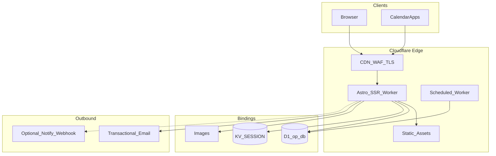

# Open Practice — Architecture Showcase

Public architecture and API documentation for **[Open Practice](https://open-practice.org)** — a free, bilingual collection of methods for clarity, self-regulation, and conscious action in everyday life.

**Live site:** [https://open-practice.org](https://open-practice.org)

This repository contains **no** application logic and **no** production data. It describes the system through diagrams, OpenAPI, and architectural notes — meant to be read, discussed, and shared without mirroring the private app repository.

> Prevention and information only — not a substitute for diagnosis or therapy.

## Help shape what comes next

Open Practice is a living, open project. If you would like to help it grow — as a practitioner, writer, therapist, designer, or engineer — you are welcome.

- **Use and share** the methods on the [live site](https://open-practice.org)
- **Write or review** bilingual content (methods, blog, events)
- **Discuss architecture** via [GitHub Issues](https://github.com/lucas-winter-berlin/OpenPracticeShowcase/issues) on this showcase
- **Get in touch** through the [contact form](https://open-practice.org/contact)

There is no paywall and no recruiting funnel. If the project resonates, say hello.

## Project vision

Knowledge about mental health and body regulation should be a common good: no paywall, no tracking, no data collection for advertising. Open Practice combines structured software architecture with an editorially curated catalog of methods, blog posts, and practice events.

The platform is for practitioners, guest authors, and moderators who publish bilingual (DE/EN) content — with a clear review workflow rather than an open wiki.

## Tech stack

| Layer | Technology |
| :--- | :--- |
| UI & SSR | [Astro](https://astro.build) 7, `server` output |
| Edge runtime | Cloudflare Workers via `@astrojs/cloudflare` |
| Relational data | Cloudflare D1 (SQLite at the edge), binding `op_db` |
| Rate limits | Cloudflare KV, binding `SESSION` |
| Media | Cloudflare Images, binding `IMAGES` |
| Auth | Magic Link (HttpOnly session in D1); password login disabled |
| Transactional mail | External mail provider (secrets only, not in this repo) |
| Rich text | Quill (dashboard editor) |
| Quality | TypeScript, Vitest, Playwright, Wrangler 4 |

Production secrets (`API_KEY`, sender addresses, optional webhooks) live only in the Worker secret store — **not** in this repository.

## Feature highlights

- **Method catalog** — bilingual exercises with steps, categories, and optional scheduling (`draft` / `scheduled` / `published`)
- **Blog** — posts with categories, related methods, and review status
- **Events** — dates with location, price, and language; public ICS feed
- **DE/EN without prefixes** — listings share a URL (`/`, `/blog`, `/events`); content pages use partner paths (`/kontakt` ↔ `/contact`)
- **Favorites in the browser only** — `localStorage` / `sessionStorage`, no server sync
- **Dashboard & roles** — admin flag, trust level (`draft` / `approved` / `verified`), and fine-grained `can_*` grants
- **Contact form** — public, honeypot- and rate-limit-protected, not stored in D1
- **Scheduled publishing** — separate cron worker (hourly posts/methods, daily event archival)

## System architecture

**Runtime model:** one SSR worker serves HTML pages and `/api/*` on the same origin. Sessions live in D1 (`user_sessions`), not in KV. KV is used only for rate limiting (magic link, contact). Staging reuses the `op_db` binding name but points at a **separate** D1 instance.

## Documentation

| Document | Contents |
| :--- | :--- |
| [docs/architecture.md](docs/architecture.md) | Edge infrastructure, bindings, i18n routing, D1 ER model |
| [openapi.yaml](openapi.yaml) | Public and authenticated HTTP endpoints |

## What this repository deliberately omits

- Application code, queries, and dashboard controllers
- Seed data, dumps, and personal content
- API keys, webhooks, internal preview hosts, session tokens
- Production environment variables

Derivations from the private app repo follow the showcase rule: **abstract, sanitize, document**.
