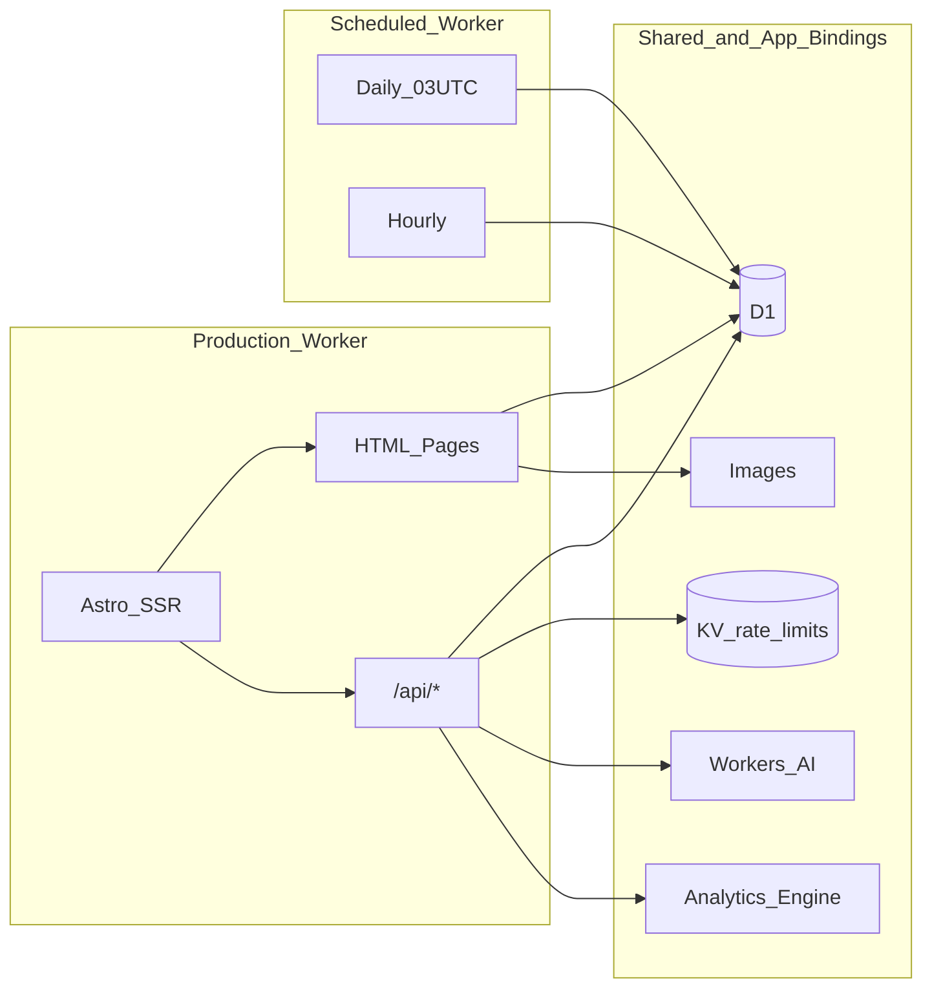
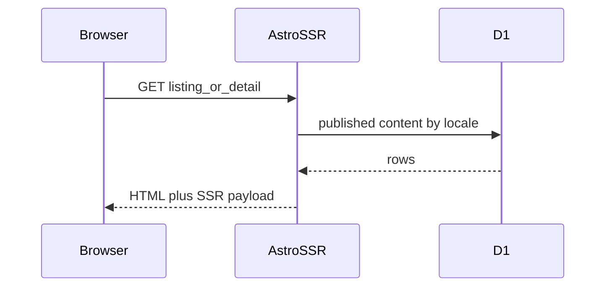
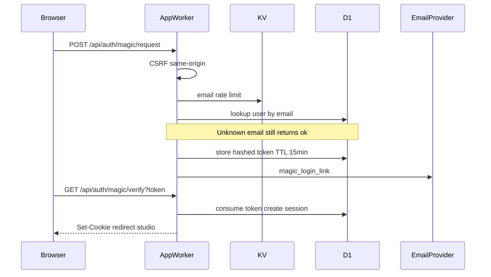
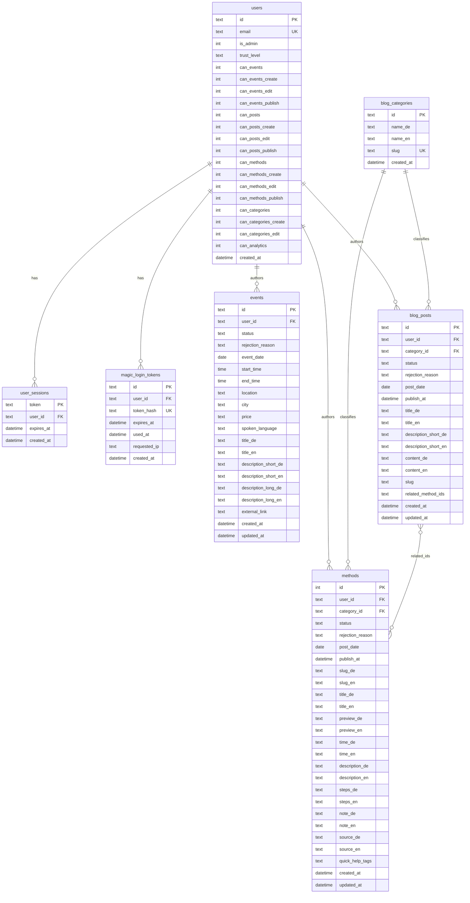
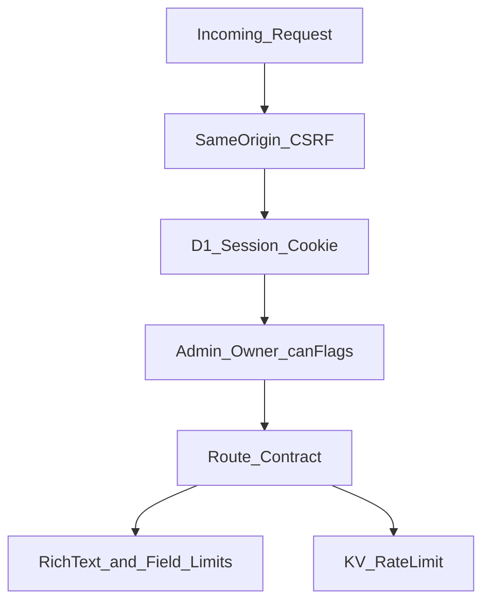

# Architecture: Cloudflare Edge & D1

Technical view of Open Practice as an **SSR worker on the Cloudflare edge**. No production IDs, no seeds, no handler implementations.

## 1. Edge infrastructure

Two workers share the same logical database and fill different roles.

| Component | Role |
| :--- | :--- |
| **App worker** | Astro `output: 'server'` + Cloudflare adapter. Serves HTML (SSR injection of public catalogs) and JSON/ICS under `/api/*`. Custom domains only - no public `*.workers.dev`. |
| **Scheduled worker** | Cron: daily at 03:00 UTC, set events older than five days to `draft` (rows are kept) and delete expired sessions and magic-link tokens. Hourly, publish due blog posts and methods from `scheduled` to `published`. Not deployed with the app worker. |
| **D1 `op_db`** | Users, sessions, magic-link tokens, events, blog, methods, categories. |
| **KV `SESSION`** | Rate limits only (magic-link, contact, studio translate). **Not** used for session storage. |
| **Workers AI** | Studio translate. Does not write D1. |
| **Analytics Engine** | Same-origin telemetry. Studio analytics reads it back. |
| **Images** | Media binding for the app. |
| **ASSETS** | Client bundle from the Astro build. |

### Environments

| Environment | Pattern |
| :--- | :--- |
| Production | Custom domain, production D1, mail delivery required for magic link and contact |
| Preview / staging | Separate worker name, **separate** D1, same `op_db` binding. Without mail config: safe no-op (no send, API still returns `ok`) |
| Local | Wrangler-local D1 for dev and E2E - isolated from remote data |

Outbound (capabilities only, no URLs): transactional email (primary) and an optional notify webhook `{ kind, payload }`.

## 2. Request flows

### Public page

### Magic link (auth)

Password login (`POST /api/auth/login`) is permanently `410 Gone`.

### Mutating studio APIs

1. Session cookie (HttpOnly, `SameSite=Lax`, `Secure`, 7-day TTL) checked against `user_sessions` ⋈ `users`
2. CSRF: reject `Sec-Fetch-Site: cross-site`; if `Origin` is set, it must match the request origin
3. Authorization: `is_admin` bypasses grants and owner checks. Otherwise show-tab plus the matching create / edit / publish flag, and owner (`user_id`) for updates and deletes
4. Events use the same grant model as posts and methods. There is no "any signed-in user may create events" exception

### Content-read API

Bearer token, GET only, six routes under `/api/content/{posts,methods,events}`. Published rows only. No session, no CSRF, no CORS. Empty or missing token secret → `503`; wrong Bearer → `401`. Query: `lang` (`de` default), list `q` and `limit` (1–100), event list also `dateFrom` / `dateTo`. Responses omit `userId`, status, rejection reasons, and email.

### Telemetry

`POST /api/telemetry` is same-origin. CSRF applies. Always `204` for a trusted request, including when the body is discarded. No visitor id. Verified bots are not written.

## 3. i18n and public surfaces

| Mode | Examples | Language switch |
| :--- | :--- | :--- |
| Toggle | `/`, `/blog`, `/events` | Same URL, UI locale |
| Navigate | `/favoriten` ↔ `/favorites`, site pages | Partner URL |
| Detail | `/methoden/{slug}`, `/methods/{slug}`, `/blog/{slug}`, `/events/{slug}` | Resource partner URL |

Static legal/content pages (about, privacy, imprint, contact) live as content, **not** in D1. The sitemap (`/sitemap.xml`) mixes registry URLs with published D1 entries at runtime.

Favorites stay client-side. Legacy paths `/praxis` and `/practice` 301-redirect to the saved-items pages.

## 4. D1 data model

Abstract relational model. No seed rows, no dumps.

### Semantics (no DDL script)

| Topic | Rule |
| :--- | :--- |
| IDs | Users, events, posts, categories: text/UUID. Methods: stable **integer** IDs (favorites and related methods). |
| Bilingual | `_de` / `_en` columns, no locale tables. |
| Status | Content: `draft` \| `scheduled` \| `published` \| `rejected` (events have no `scheduled`). |
| Trust | `draft` (review), `approved`, `verified`. Independent of `can_*`. Publish is the matching `can_*_publish` flag, not trust. |
| Related methods | `blog_posts.related_method_ids` is a serialized ID list, not a join table. |
| Categories | Delete is blocked while posts or methods still reference the category. |
| Auth tokens | Magic link stores a **hash**, not plaintext; one-time use via `used_at`. |

Useful index families: `(status, post_date)` and `user_id` / `category_id` on posts and methods; slugs and `(status, publish_at)` on methods.

## 5. Security architecture (as built)

| Layer | Contract |
| :--- | :--- |
| CSRF | Mutating routes except documented public exceptions |
| Session | Cookie `op_session`, validated against D1, not KV |
| XSS | Server-side rich-text allowlist; tight field length limits |
| HTTP | CSP, `X-Frame-Options: DENY`, `nosniff`, JSON `Cache-Control: no-store` |
| Rate limit | Magic link (email, fail-open without KV); contact (IP, fail-closed in production without KV); studio translate (per user, fail-closed without KV) |
| Enumeration | Unknown magic-link email → same `ok` as a known address |
| Contact | No D1 insert; honeypot field still answered with `ok` |

Left open by design: no global API throttling; CSP is maintained by hand.

## 6. Quality gates (no pipeline code)

Typical chain before a production deploy: dependency audit (high) → unit and security coverage → worker build → bundle/cron smoke → E2E. Remote D1 writes are operationally gated (confirmation), separate from this showcase.

## 7. API reference

Full HTTP contracts: [../openapi.yaml](../openapi.yaml). Product map: [features.md](features.md). Pages and workers: [structure.md](structure.md). Grants and publish: [studio.md](studio.md).
