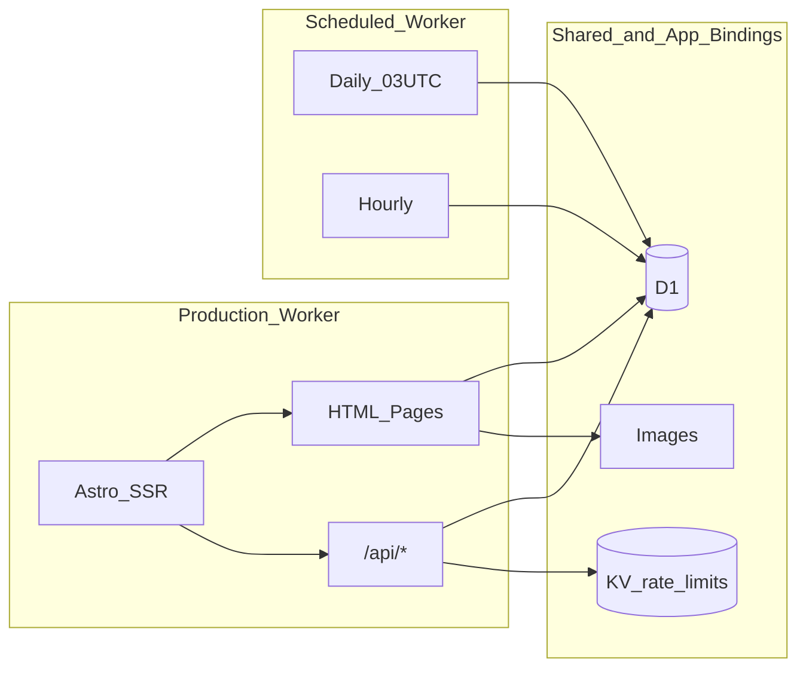
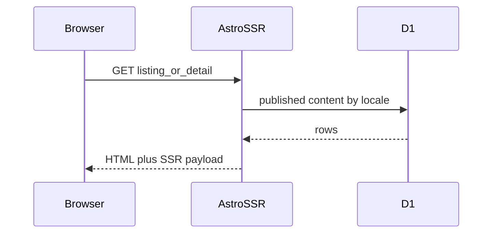
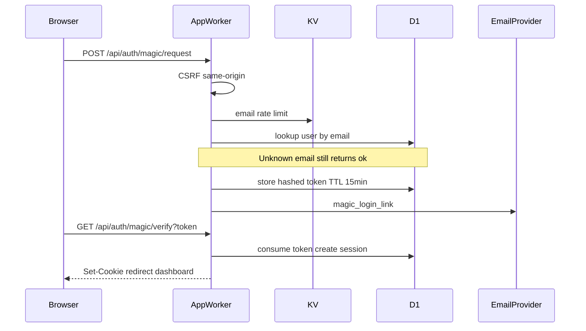
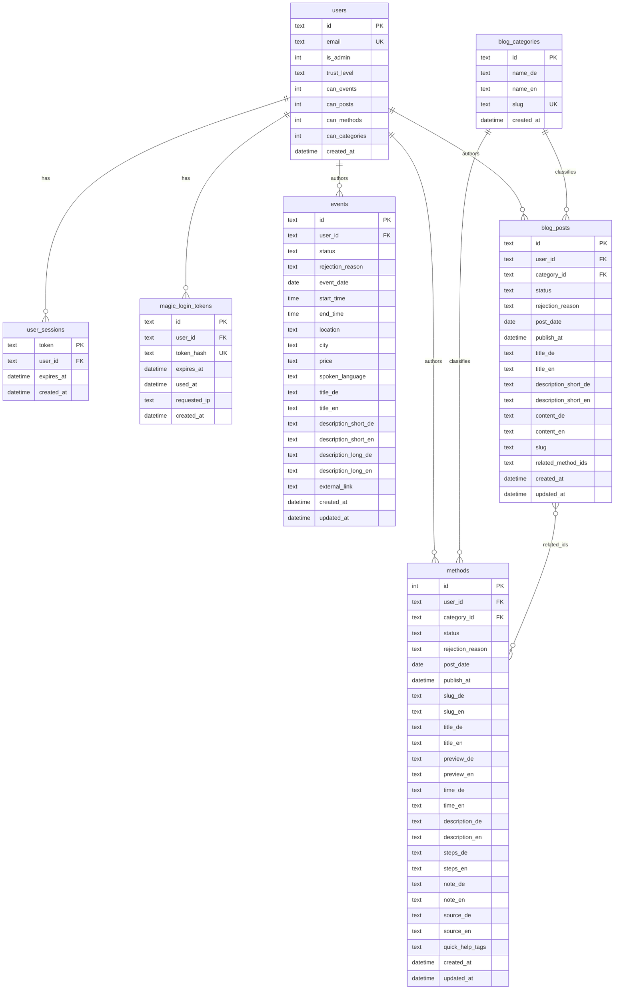
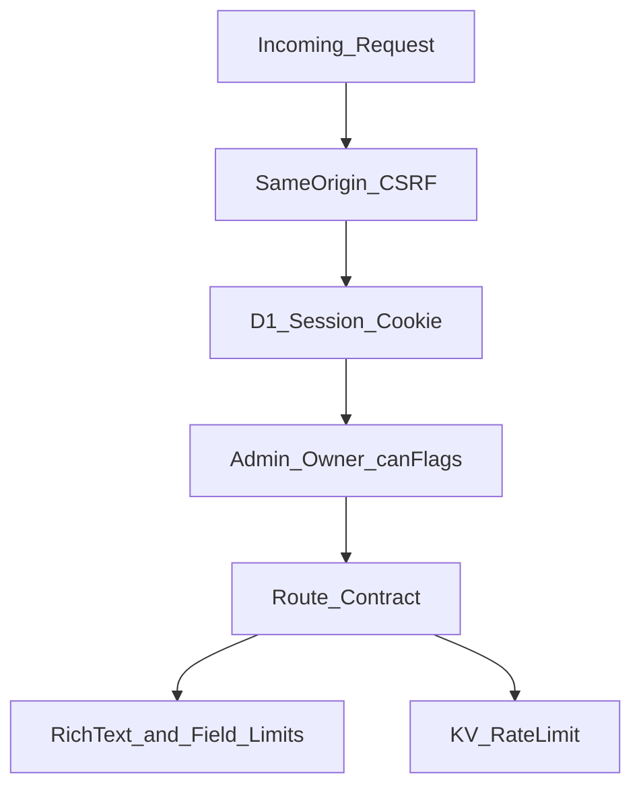

# Architektur: Cloudflare Edge & D1

Technische Sicht auf Open Practice als **SSR-Worker am Cloudflare-Edge**. Keine produktiven IDs, keine Seeds, keine Handler-Implementierung.

## 1. Edge-Infrastruktur

Zwei Worker teilen sich dieselbe logische Datenbank, erfüllen aber unterschiedliche Rollen.

| Komponente | Rolle |
| :--- | :--- |
| **App-Worker** | Astro `output: 'server'` + Cloudflare-Adapter. Liefert HTML (SSR-Injection öffentlicher Kataloge) und JSON/ICS unter `/api/*`. Custom Domains, kein öffentliches `*.workers.dev`. |
| **Scheduled Worker** | Cron: täglich 03:00 UTC Events mit Datum älter als fünf Tage auf `draft` setzen (Datensatz bleibt). Stündlich fällige Blog-Posts und Methoden von `scheduled` nach `published`. |
| **D1 `op_db`** | Nutzer, Sessions, Magic-Link-Tokens, Events, Blog, Methoden, Kategorien. |
| **KV `SESSION`** | Nur Rate-Limits. **Keine** Session-Speicherung. |
| **Images** | Medien-Binding der App. |
| **ASSETS** | Client-Bundle des Astro-Builds. |

### Umgebungen

| Umgebung | Muster |
| :--- | :--- |
| Production | Custom Domain, D1-Produktion, Mail-Versand Pflicht für Magic Link und Kontakt |
| Preview / Staging | Eigener Worker-Name, **eigene** D1, gleiches Binding `op_db`. Ohne Mail-Konfiguration: sicheres No-Op (kein Versand, API bleibt `ok`) |
| Lokal | Wrangler-lokale D1 für Dev und E2E — getrennt von Remote-Daten |

Outbound (nur als Capabilities, ohne URLs): transaktionale E-Mail (primär) und optionaler Notify-Webhook `{ kind, payload }`.

## 2. Request-Flüsse

### Öffentliche Seite

### Magic Link (Auth)

Passwort-Login (`POST /api/auth/login`) ist dauerhaft `410 Gone`.

### Mutierende Dashboard-APIs

1. Session-Cookie (HttpOnly, `SameSite=Lax`, `Secure`, TTL 7 Tage) gegen `user_sessions` ⋈ `users`
2. CSRF: `Sec-Fetch-Site: cross-site` ablehnen; gesetztes `Origin` muss Request-Origin entsprechen
3. Autorisierung: `is_admin`, Owner (`user_id`) oder `can_posts` / `can_methods` / `can_categories`
4. Events anlegen: jeder authentifizierte Account (kein `can_events`-Gate auf API-Ebene)

## 3. i18n und öffentliche Oberflächen

| Modus | Beispiele | Sprachwechsel |
| :--- | :--- | :--- |
| Toggle | `/`, `/blog`, `/events` | Gleiche URL, UI-Locale |
| Navigate | `/favoriten` ↔ `/favorites`, Site Pages | Partner-URL |
| Detail | `/methoden/{slug}`, `/methods/{slug}`, `/blog/{slug}`, `/events/{slug}` | Partner-URL der Ressource |

Statische Rechtstexte (About, Datenschutz, Impressum, Kontakt) liegen als Content, **nicht** in D1. Die Sitemap (`/sitemap.xml`) mischt Registry-URLs mit zur Laufzeit veröffentlichten D1-Einträgen.

Favoriten bleiben clientseitig. Legacy-Pfade `/praxis` und `/practice` leiten per 301 auf die Gespeichert-Seiten.

## 4. D1-Datenmodell

Abstraktes Relationenmodell. Keine Seed-Zeilen, keine Dumps.

### Semantik (ohne DDL-Skript)

| Thema | Regel |
| :--- | :--- |
| IDs | Nutzer, Events, Posts, Kategorien: Text/UUID. Methoden: stabile **Integer**-IDs (Favoriten und Related Methods). |
| Bilingual | `_de` / `_en` Spalten, keine Locale-Tabellen. |
| Status | Inhalte: `draft` \| `scheduled` \| `published` \| `rejected` (Events ohne `scheduled`). |
| Trust | `draft` (Review), `approved` (kann direkt publizieren), `verified`. Unabhängig von `can_*`. |
| Related Methods | `blog_posts.related_method_ids` ist eine serialisierte ID-Liste, kein Join-Table. |
| Kategorien | Löschen blockiert, solange Posts oder Methoden referenzieren. |
| Auth-Tokens | Magic-Link speichert **Hash**, nicht Klartext; Einmalnutzung über `used_at`. |

Nützliche Index-Familien: `(status, post_date)` und `user_id` / `category_id` auf Posts und Methoden; Slugs und `(status, publish_at)` auf Methoden.

## 5. Sicherheitsarchitektur (Ist)

| Ebene | Vertrag |
| :--- | :--- |
| CSRF | Mutierende Routen außer dokumentierten Public-Sonderfällen |
| Session | Cookie `op_session`, Validierung gegen D1, nicht KV |
| XSS | Server-seitige Rich-Text-Allowlist; enge Längenlimits |
| HTTP | CSP, `X-Frame-Options: DENY`, `nosniff`, JSON `Cache-Control: no-store` |
| Rate-Limit | Magic Link (E-Mail, fail-open ohne KV); Kontakt (IP, fail-closed in Production ohne KV) |
| Enumeration | Unbekannte Magic-Link-E-Mail → gleiches `ok` wie bekannte |
| Kontakt | Kein D1-Insert; Honeypot-Feld wird still mit `ok` beantwortet |

Bewusst offen: kein globales API-Throttling; CSP wird manuell gepflegt.

## 6. Qualitätsgatter (ohne Pipeline-Code)

Typische Kette vor einem Production-Deploy: Dependency-Audit (high) → Unit- und Security-Coverage → Worker-Build → Bundle-/Cron-Smoke → E2E. Remote-D1-Schreiben ist betrieblich gegated (Bestätigung), getrennt von diesem Showcase.

## 7. API-Verweis

Vollständige HTTP-Verträge: [../openapi.yaml](../openapi.yaml).
